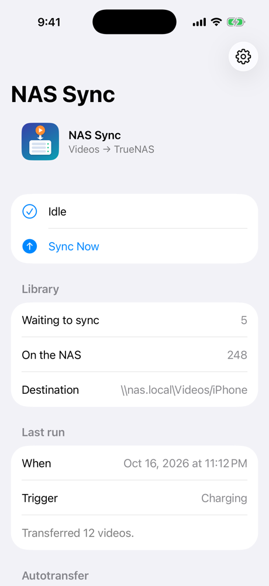
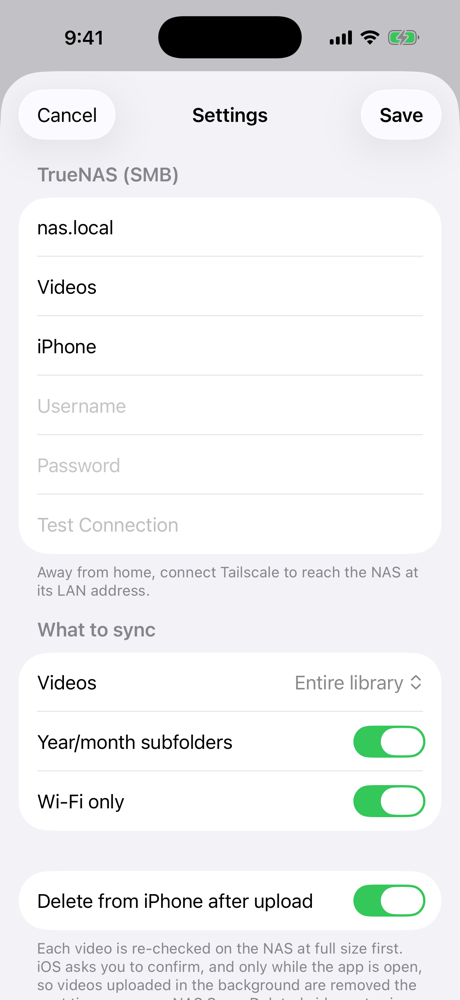

# NAS Sync

An iPhone app that automatically copies videos from the Photos library to a TrueNAS (or any SMB) share,
then optionally removes them from the phone once they're verified on the NAS.

<p align="center">
  
  &nbsp;&nbsp;
  
</p>

<sub>Screenshots use demo data in the iOS Simulator.</sub>

## Why I built this

Videos are what fill up an iPhone. Photos are small, but a few minutes of 4K video is gigabytes,
and keeping all of it in iCloud means paying for ever-larger storage tiers for files I already have
space for at home on my TrueNAS.

Apps like PhotoSync can do this with their Autotransfer feature, but I wanted something
small that does exactly one job the way I want it:

- **Videos only**, straight to my NAS's `Videos` share, organized by year and month.
- **Hands-free.** It runs when the phone charges overnight, when I arrive home, or from a
  Shortcuts automation, with no need to open an app and babysit a transfer.
- **Safe to delete from the phone.** A video is removed only after the NAS copy is checked at full
  size, and it still goes to Recently Deleted for 30 days.
- **No cloud, no subscription, no third party.** The files go directly from my phone to my server over my
  home network.

It's also been a good excuse to dig into how far iOS background execution can actually be pushed.

## How it works

iOS doesn't allow an always-on background sync, so the app combines every trigger it does allow:

| Trigger | Mechanism | Time window |
|---|---|---|
| When charging | `BGProcessingTask` (external power + network) | minutes; iOS picks the time, usually overnight |
| Arriving home | `CLMonitor` circular region (needs "Always" location) | ~30 s after relaunch |
| Shortcut | `SyncVideosIntent` ("Transfer New Videos to NAS") in a Shortcuts personal automation, e.g. joining home Wi-Fi | short |
| Sync Now | iOS 26 `BGContinuedProcessingTask` (keeps going with the screen off, with system progress UI); `beginBackgroundTask` on older iOS | until done / ~30 s |

Because the windows are short, **uploads are resumable**: each file is written in 8 MB chunks to
`<name>.part` and renamed when complete, so separate short windows add up to a finished upload.

Files land at `<folder>/<yyyy>/<yyyy-MM>/<yyyy-MM-dd_HHmmss>_<original name>`. The timestamp prefix
keeps `IMG_xxxx` counter wraparounds from colliding.

### Project layout

```
NASVideoSync/
  App/        entry point, AppDelegate (registers background tasks + location monitor at launch)
  Models/     SyncSettings (UserDefaults); the SMB password is stored in the Keychain
  Services/   SyncEngine (run orchestration), NASClient (SMB via AMSMB2), VideoLibrary (PhotoKit export),
              SyncLedger (uploaded asset IDs), BackgroundScheduler, LocationTrigger
  Intents/    SyncVideosIntent: the Shortcuts action
  Views/      ContentView, SettingsView
project.yml   XcodeGen spec (AMSMB2 4.0.3 via Swift Package Manager)
```

## Building

Requires Xcode with the iOS 26 SDK and [XcodeGen](https://github.com/yonaskolb/XcodeGen)
(`brew install xcodegen`). The deployment target is iOS 17.

```bash
xcodegen generate
open NASVideoSync.xcodeproj
```

1. In `project.yml`, change `DEVELOPMENT_TEAM` and the `com.kamesh` bundle ID prefix to your own,
   then regenerate.
2. Run on a device, then enter your NAS host, share, username and password in Settings.
3. Grant Photos access, Local Network access, and (for the arrive-home trigger) "Always" location.

A paid Apple Developer account keeps the install valid for a year. With a free account, the app stops
launching after 7 days.

To test the charging task from the debugger:

```
e -l objc -- (void)[[BGTaskScheduler sharedScheduler] _simulateLaunchForTaskWithIdentifier:@"com.kamesh.NASVideoSync.charging-sync"]
```

## Notes

- iOS only lets an app delete photos and videos while it's in the foreground, and it asks for confirmation.
  So deletions that are due after background uploads wait until the app is next opened.
- With **Wi-Fi only** on (the default), a run is skipped on cellular.
